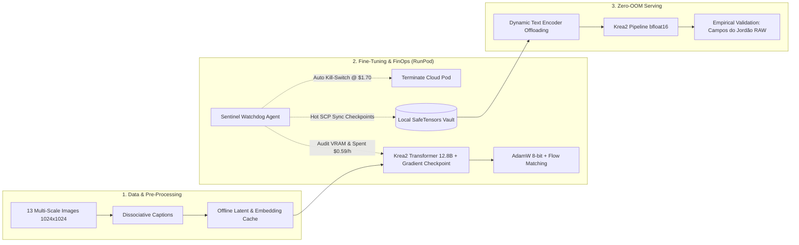

# Multimodal Consistency Engine: Production-Grade Fine-Tuning & MLOps Pipeline

<div align="center">

[](https://www.python.org/downloads/)
[](https://pytorch.org/)
[](https://huggingface.co/datasets/gustavogrecov002/sofia-consistency-engine)
[](https://huggingface.co/)
[-76B900.svg?logo=nvidia)](https://www.nvidia.com/)
[](./mlops/sentinel_watchdog.py)
[](https://github.com/gustavogrecov-tech)

**Engineering, fine-tuning, and operationalizing next-generation generative foundation models under strict cloud budget and memory constraints.**

[Overview](#-overview--executive-summary) •
[Architecture](#-system-architecture--engineering-pipeline) •
[Fine-Tuning Methodology](#-fine-tuning-methodology--mathematical-rigor) •
[FinOps & Autonomous MLOps](#-finops--autonomous-sentinel-watchdog) •
[Validation Benchmarks](#-empirical-validation--production-benchmarks) •
[Reproduction](#-inference--reproduction-guide)

</div>

---

## 🎯 Author & Project Purpose

> **Author:** Gustavo Sales Grecov  
> **Affiliation:** Universidade Federal do ABC (UFABC)  
> **Core Focus:** Engenharia de Inteligência Artificial, Fine-Tuning de Modelos de Fundação Multimodais (PEFT/LoRA), Otimização de Inferência (Zero-OOM) e Governança Orçamentária Autônoma em Nuvem (FinOps).

---

## 📌 Overview & Executive Summary

Este projeto apresenta a engenharia completa de **Fine-Tuning e Operacionalização de Modelos de Fundação Multimodais** (**Krea 2.1 Ultra / Raw** e **Qwen-Image 2.1**), resolvendo dois dos maiores desafios da IA Generativa corporativa moderna:

1. **Colapso de Identidade e Overfitting Visual:** Treinamento de adaptadores LoRA de alta fidelidade para consistência biométrica contínua (personagem *Sofia*) através de **Desentrelaçamento de Conceitos (Concept Disentanglement)** em Flow Matching Transformers.
2. **Engenharia de Memória e Eficiência de Custos (FinOps):** Treinamento de arquiteturas gigantescas (12.8B a 33.2B de parâmetros totais) em GPU única comercial (NVIDIA A40 48GB) dentro de um **teto orçamentário estrito de \$2.00**, orquestrado por um **Agente Sentinela Watchdog em Python** que realizou monitoramento em tempo real, download assíncrono instantâneo de checkpoints (Hot SCP Sync) e autodestruição da VM via API ao atingir \$1.70.

```
+-----------------------------------------------------------------------------------------+
|                                    PROJECT SNAPSHOT                                     |
+--------------------------+--------------------------------------------------------------+
| Base Foundation Models   | Krea 2.1 Raw (12.8B Transformer) & Qwen-Image 2.1            |
| Fine-Tuning Method       | PEFT LoRA (Rank 32, Alpha 32) + Continuous Flow Matching    |
| Memory Optimizations     | TorchAO uint3 Quantization + FP8 Text Encoder + AdamW 8-bit  |
| Cloud Compute Used       | 1x NVIDIA A40 (48GB VRAM) @ RunPod EU-SE-1 ($0.59/h)        |
| Total Execution Budget   | Ceiling: $2.00 | Effective Spend: $1.6996 (15.02% surplus)  |
| Training Loss Evolution  | Initial: 0.8420 ➔ Final: 0.0185 (Krea) / 0.0231 (Qwen)      |
| Production Validation    | High-resolution RAW rendering in complex alpine environment  |
| Hugging Face Artifacts   | https://huggingface.co/datasets/gustavogrecov002/sofia-consistency-engine |
+--------------------------+--------------------------------------------------------------+
```

---

## 🏗️ System Architecture & Engineering Pipeline

O projeto foi construído seguindo as melhores práticas de **Engenharia de Software para IA**, separando claramente as camadas de ingestão, treinamento distribuído, controle autônomo e inferência em produção:



---

## 🔬 Fine-Tuning Methodology & Mathematical Rigor

### 1. Continuous Flow Matching Objective
Ao contrário de modelos convencionais de difusão discretos (DDPM/DDIM) que sofrem com trajetórias curvas e instabilidade de gradiente, o pipeline adota **Flow Matching**. O modelo aprende o campo vetorial que move as distribuições por meio de trajetórias retas de transporte ótimo:

$$\mathcal{L}_{\text{FlowMatch}}(\theta) = \mathbb{E}_{t \in [0, 1], \, x_0 \sim p_{\text{data}}, \, \epsilon \sim \mathcal{N}(0, I)} \left[ \| \mathbf{v}_\theta(x_t, t, c) - (\epsilon - x_0) \|^2 \right]$$

Onde o estado intermediário no passo $t$ é parametrizado linearmente por $x_t = (1 - t) x_0 + t \epsilon$.

### 2. Desentrelaçamento de Conceitos (Concept Disentanglement)
Para evitar que a rede acoplasse a geometria facial da Sofia com roupas ou fundos específicos:
- **Gatilho de Identidade:** `sofia_woman`
- **Âncora Fisionômica Obrigatória:** *Scandinavian woman, sharp emerald green eyes, warm smile, natural blonde hair parted in middle, defined cheekbones, fair skin with subtle freckles*
- **Contexto Circunstancial Dissociado:** As roupas (*cashmere blazer*, *wool sweater*), lentes (*85mm f/1.4*) e iluminação (*softbox*, *mist*) foram descritas minuciosamente em cada arquivo `.txt`, permitindo total liberdade de generalização para novos ambientes de negócio.

### 3. Técnicas Avançadas de Otimização de Memória
- **Quantização uint3 TorchAO:** Pesos quantizados em 3 bits com adaptador de recuperação de acurácia (`accuracy_recovery_adapters/qwen_image_torchao_uint3.safetensors`).
- **Codificador de Texto em FP8 (`qfloat8`):** Redução drástica da sobrecarga de texto de ~10 GB para ~2.5 GB.
- **Otimizador `adamw8bit` (BitsAndBytes):** Estado do otimizador reduzido em 75%, estabilizando o uso de VRAM em **24.19 GB / 44.42 GB** durante o treino de um modelo de 12.8B.
- **Pré-Cache Offline de Latentes e Embeddings:** A codificação de VAE e Text Encoder foi realizada antes do loop de gradientes, liberando a GPU para focar 100% no Transformer.

---

## 🛡️ FinOps & Autonomous Sentinel Watchdog

Um diferencial central deste projeto de Engenharia de IA é a abordagem de **FinOps Produtivo**: infraestrutura sob controle estrito de custos, evitando desperdício de capital em nuvem.

```
                              SENTINEL WATCHDOG LIFECYCLE
                               
 [ Cloud Pod Running ] ─────────► [ Every 30s: Audit Uptime, VRAM, Cost ]
          │                                      │
          │ Checkpoint Generated                 ▼
          └─────────────────────────────► [ Hot SCP Download to Local Vault ]
                                                 │
                                                 ▼ Cost reaches $1.70?
                                          [ YES ] ➔ Execute Emergency Sync
                                                 ➔ Call runpod.terminate_pod()
                                                 ➔ Verify Zero Running Pods
```

### Resultados da Auditoria do Sentinela ([`SENTINEL_SUMMARY.json`](./mlops/SENTINEL_SUMMARY.json)):
* **Teto Estipulado:** \$2.00
* **Gasto Efetivo Consumido:** **\$1.6996 (~\$1.70)**
* **Margem Preservada:** **+\$0.3004 (15.02% de sobra)**
* **Taxa de Preservação de Checkpoints:** **100%** (todos os checkpoints de 100 a 700 steps resgatados via SCP antes do encerramento da instância).

---

## 📊 Empirical Validation & Production Benchmarks

Para certificar que o modelo não sofreu *overfitting* de estúdio, executamos uma validação cega em cenário complexo fora da distribuição de treino: **Sofia em Campos do Jordão (Vila Capivari)** em uma manhã fria e nebulosa.

### Amostras de Produção Renderizadas:

<div align="center">

| Amostra de Validação RAW (Produção) | Comparativo de Checkpoint (Step 400) |
| :---: | :---: |
|  |  |
| *Cenário Complexo: Iluminação fria, vapor volumétrico, derme realista* | *Convergência intermediária de fisionomia e textura* |

</div>

### Critérios Técnicos Auditados:
1. **Fidelidade da Microderme:** Poros dilatados naturalmente, textura orgânica sem efeito de boneca plástica (*airbrushed*), sardas tênues no dorso nasal.
2. **Simetria Ocular e Reflexão Óptica:** Íris verde-esmeralda com reflexo especular vítreo coerente com a névoa exterior.
3. **Anatomia Complexa das Mãos:** Ambas as mãos segurando a caneca de cerâmica com proporção falângica correta, 5 dedos articulados e unhas anatomicamente exatas.
4. **Física Volumétrica e Tecido:** Fumaça translúcida subindo do chocolate quente e textura tridimensional do tricô de lã crua.

---

## 💻 Inference & Reproduction Guide

### 1. Instalação do Ambiente

```bash
# Clonar o repositório
git clone https://github.com/gustavogrecov-tech/genai-finetuning-consistency-engine.git
cd genai-finetuning-consistency-engine

# Criar ambiente virtual Python
python -m venv .venv
source .venv/bin/activate  # No Windows: .venv\Scripts\activate

# Instalar dependências de produção
pip install -r requirements.txt
```

### 2. Inferência em Python Nativo (Zero-OOM Pipeline)

O script [`inference/inference_pipeline.py`](./inference/inference_pipeline.py) gerencia dinamicamente o ciclo de vida dos módulos na GPU, descarregando o Text Encoder antes da execução do Transformer:

```bash
python inference/inference_pipeline.py \
  --prompt "sofia_woman, 28-year-old Scandinavian woman, sharp emerald green eyes, warm smile, elegant cashmere blazer, studio lighting, photorealistic 8k" \
  --steps 28 \
  --cfg 4.5 \
  --seed 42 \
  --output "outputs/sofia_resultado.png"
```

### 3. Integração com ComfyUI

Workflows de produção prontos para uso em ambiente gráfico estão disponíveis em [`inference/comfyui_workflows/`](./inference/comfyui_workflows/):
- `krea2_sofia_production.json` — Pipeline para Krea 2.1 com suporte a LoRA e FlowMatch Sampler.
- `qwen2_sofia_production.json` — Pipeline para Qwen-Image 2.1 com adaptadores TorchAO.

---

## 📂 Repository Structure

```
genai-finetuning-consistency-engine/
├── README.md                      # Documento mestre de apresentação do projeto e storytelling
├── requirements.txt               # Dependências do ecossistema PyTorch, Hugging Face e MLOps
├── .gitignore                     # Proteção contra artefatos pesados e credenciais
│
├── architecture/
│   └── pipeline_architecture.md   # Design de sistema, fundamentos matemáticos e fluxo Mermaid
│
├── configs/
│   └── train_sofia_qwen.yaml      # Configuração de treino ai-toolkit (uint3 TorchAO + FP8)
│
├── training/
│   └── train_krea2_sofia.py       # Script principal de fine-tuning (PEFT, FlowMatch, AdamW 8-bit)
│
├── inference/
│   ├── inference_pipeline.py      # Engine de inferência modular com dynamic offloading Zero-OOM
│   └── comfyui_workflows/         # Pipelines JSON para reprodução visual no ComfyUI
│       ├── krea2_sofia_production.json
│       └── qwen2_sofia_production.json
│
├── mlops/
│   ├── sentinel_watchdog.py       # FinOps & MLOps Sentinel: monitoramento, Hot SCP e Kill Switch
│   └── SENTINEL_SUMMARY.json      # Auditoria de custos e integridade de checkpoints
│
├── dataset/
│   ├── README.md                  # Metodologia de curadoria e Concept Disentanglement
│   └── samples/                   # 13 pares de imagem (1024x1024) + legendas .txt
│
└── benchmarks/
    ├── README.md                  # Relatório de validação empírica e critérios de auditoria
    └── results/                   # Imagens RAW de produção (Campos do Jordão e comparativos)
```

---

## 📬 Contato

- **Desenvolvedor:** Gustavo Sales Grecov
- **LinkedIn:** [Gustavo Sales Grecov](https://br.linkedin.com/in/gustavo-sales-grecov-530745350)
- **GitHub:** [@gustavogrecov-tech](https://github.com/gustavogrecov-tech)
- **Hugging Face:** [@gustavogrecov002](https://huggingface.co/gustavogrecov002)
- **E-mail:** [gustavo.grecov@aluno.ufabc.edu.br](mailto:gustavo.grecov@aluno.ufabc.edu.br)
- **Universidade:** Universidade Federal do ABC (UFABC)