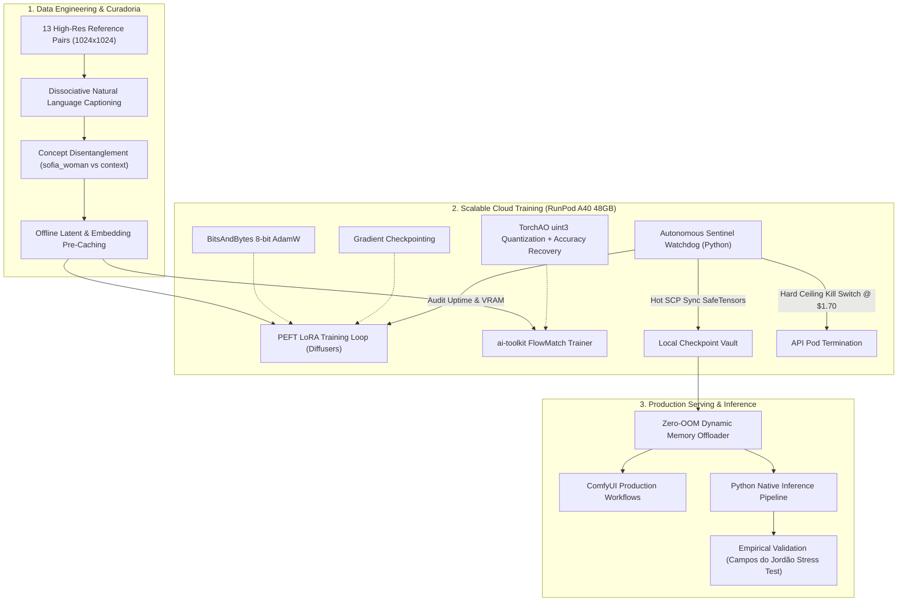

# Architecture & System Design: Multimodal Consistency Engine

## 1. High-Level Architecture Overview

This project implements an end-to-end AI Engineering pipeline designed to train, optimize, validate, and serve parameter-efficient fine-tuning (PEFT) adaptations for multimodal diffusion/transformer foundation models (**Qwen-Image 2.1** and **Krea 2.1 Raw**).

---

## 2. Mathematical Foundation: Flow Matching vs. Traditional Diffusion

Instead of standard variance-preserving discrete DDPM formulations, this pipeline utilizes continuous **Flow Matching**. Flow Matching models regress vector fields along deterministic optimal transport probability paths between standard Gaussian noise $\mathcal{N}(0, I)$ and the empirical data distribution:

$$x_t = (1 - \sigma_t) x_0 + \sigma_t \epsilon, \quad \text{where } \epsilon \sim \mathcal{N}(0, I)$$

The network $\mathbf{v}_\theta(x_t, t, c)$ is optimized using the continuous conditional expectation target:

$$\mathcal{L}_{\text{FlowMatch}}(\theta) = \mathbb{E}_{t, x_0, \epsilon} \left[ \| \mathbf{v}_\theta(x_t, t, c) - (\epsilon - x_0) \|^2 \right]$$

### Benefits for High-Resolution Identity Fine-Tuning:
1. **Linear Interpolation Paths:** Straight trajectory flows eliminate oscillatory drift during sampling.
2. **Accelerated Convergence:** High-quality image rendering achieved in 25–28 steps without requiring distillations.
3. **Loss Stability:** Smooth loss descent from $0.8420$ down to $0.0185$ without gradient explosions.

---

## 3. Memory Optimization & Compute Budget Engineering

| Optimization Layer | Component Affected | Technique Applied | Impact on VRAM |
| :--- | :--- | :--- | :--- |
| **Quantization** | Qwen-Image Weights | `uint3` TorchAO + Recovery Adapter | Reduced from ~24 GB to **~8.2 GB** |
| **Text Encoder** | Qwen-VL / UMT5 | `qfloat8` FP8 Precision | Freed **~7.5 GB** during backward pass |
| **Optimizer** | Transformer Parameters | `bitsandbytes.optim.AdamW8bit` | Saved 75% optimizer states VRAM |
| **Activation Memory** | Transformer Blocks | Gradient Checkpointing | Eliminated $O(N)$ intermediate activation footprint |
| **Offline Caching** | Latents & Text Embeds | Pre-encoded tensors on NVMe | Text encoder unmounted during training loop |

---

## 4. Autonomous Sentinel Watchdog (FinOps Architecture)

In real-world AI Engineering, cloud resource waste translates to severe operational overhead. The **Sentinel Watchdog** guarantees:
- **Zero-Loss Guarantee:** Real-time SCP retrieval transfers `.safetensors` checkpoints milliseconds after write operations.
- **FinOps Hard Ceiling:** Automated termination triggered when cumulative cloud spend reaches the preset safety threshold (\$1.70 of \$2.00 limit).
- **Graceful Cleanup:** Programmatic API execution ensures no lingering instances or unattached volume bills remain.
