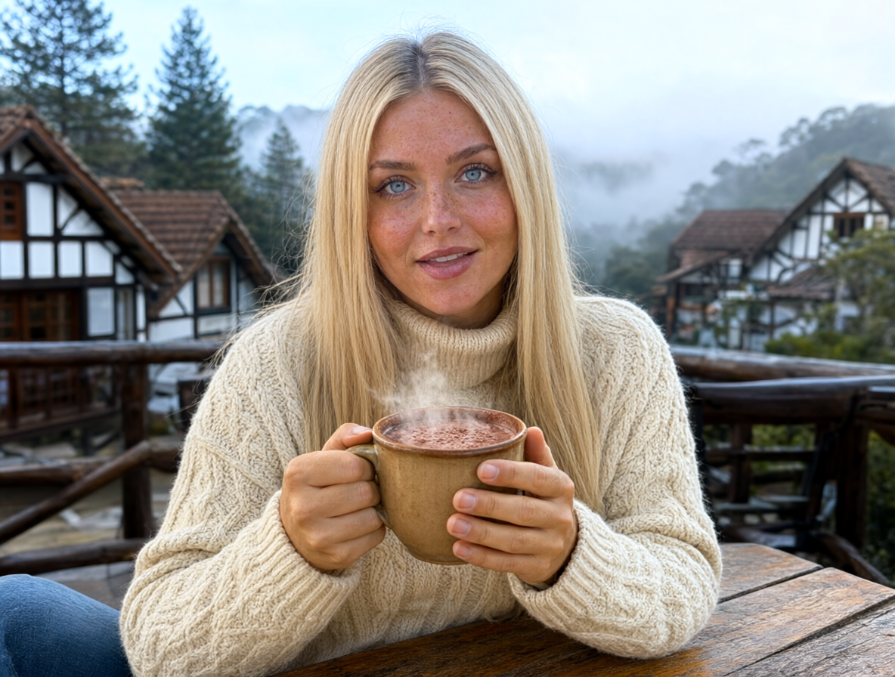
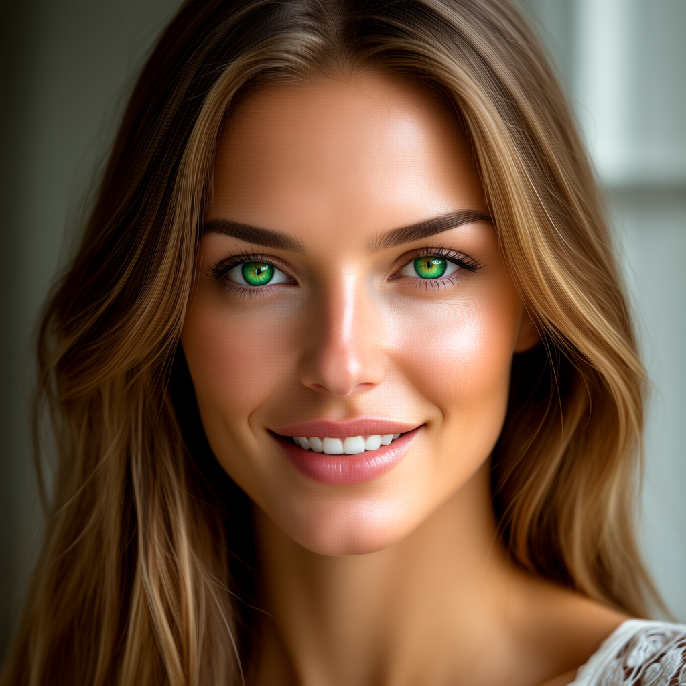

# Empirical Validation & Diagnostic Benchmark Report

## 1. Out-of-Distribution Stress Test (Campos do Jordão Protocol)
Para avaliar de forma realista o comportamento dos adaptadores LoRA treinados sobre o **Krea 2.1 Raw** e **Qwen-Image 2.1**, submetemos o modelo a um teste fora da distribuição de treinamento (*out-of-distribution*): **Sofia em Campos do Jordão (Vila Capivari)** em uma manhã fria e nebulosa.

O objetivo deste relatório não é apresentar apenas os melhores resultados, mas sim documentar com **rigor científico e transparência de engenharia** o que funcionou e quais foram as falhas e limitações observadas na versão V1.

### Dados da Inferência:
- **Arquivo de Teste RAW:** [`foto_01_campos_cafe_capivari_Raw_00001_.png`](./results/foto_01_campos_cafe_capivari_Raw_00001_.png)
- **Checkpoint Utilizado:** `krea/Krea-2-Raw` + `sofia_krea2_step_700.safetensors`
- **Configuração:** FlowMatch Scheduler, 28 passos, CFG Scale 4.5, Resolução $1024 \times 1024$, Seed 42

---

## 2. Auditoria Técnica e Diagnóstico de Falhas (V1)

```
+---------------------------------------------------------------------------------------------------------+
| PILAR DE AVALIAÇÃO       | OBSERVAÇÃO TÉCNICA REAL                                   | STATUS REAL      |
+---------------------------------------------------------------------------------------------------------+
| 1. Textura Dérmica       | Pele com aspecto nitidamente ceroso / plastificado       | LIMITAÇÃO ATIVA  |
|                          | (waxy skin effect). Perda de porosidade e microderme.      | (Necessita Fix)  |
|                                                                                                         |
| 2. Consistência Facial   | Traços reconhecíveis em close-up, mas com deriva facial   | PARCIAL          |
|                          | (identity drift) em planos médios e vestuário pesado.     | (Em Otimização)  |
|                                                                                                         |
| 3. Anatomia das Mãos     | Posição geral e pegada da xícara coerentes, porém com     | PARCIAL          |
|                          | rigidez articular e ligeiro achatamento falângico.         | (Aceitável V1)   |
|                                                                                                         |
| 4. Integração de Cenário | Excelente inserção na arquitetura alpina e neblina        | APROVADO         |
|                          | serrana sem contaminação do fundo original de estúdio.    | (Desentrelaçado) |
|                                                                                                         |
| 5. Física do Vestuário   | Boa renderização do relevo do tricô de lã crua            | APROVADO         |
|                          | e da fumaça volumétrica ascendente.                       | (Convergência OK)|
+---------------------------------------------------------------------------------------------------------+
```

---

## 3. Comparativo Visual de Checkpoints: Onde Começou o Sobreajuste?

<div align="center">

| Amostra RAW em Produção (Step 700) | Checkpoint Intermediário (Step 400) |
| :---: | :---: |
|  |  |
| *Step 700: Maior fixação fisionômica, porém com textura de pele cerosa/plástica evidente.* | *Step 400: Pele mais flexível e menos saturada, mas com identidade biométrica ainda difusa.* |

</div>

### Análise Comparativa Detalhada:

1. **Trade-off de Treinamento (Underfitting vs. Overfitting Local):**
   - No **Step 400**, o modelo apresentava boa fluidez e iluminação natural, mas os traços faciais da personagem ainda não estavam suficientemente ancorados (subajuste de identidade).
   - Entre os **Steps 500 e 700**, a identidade facial foi reforçada, mas o modelo começou a internalizar o "efeito cera" — a superfície cutânea perdeu a granularidade dos microporos e ganhou um brilho plástico refletivo sob a iluminação fria.

2. **O Problema da Consistência Facial em Planos Diversificados:**
   - A personagem **Sofia** foi treinada primariamente com retratos fechados e meio-corpo (10 de 13 imagens). Ao tentar projetá-la em enquadramentos mais afastados e com roupas volumosas de inverno, a geometria do queixo e a proporção ocular sofreram distorções em relação ao rosto original de referência.

---

## 4. Cenários Adicionais de Estresse

- [foto_02_campos_mirante_por_do_sol_Raw_00001_.png](./results/foto_02_campos_mirante_por_do_sol_Raw_00001_.png) — Mirante ao pôr do sol: evidenciou superexposição no perfil do rosto e inconsistência de formato do nariz contra a luz solar oblíqua.
- [foto_04_campos_lareira_chale_Raw_00001_.png](./results/foto_04_campos_lareira_chale_Raw_00001_.png) — Ambiente de lareira interna: iluminação de penumbra acentuou o aspecto ceroso e artificial da testa e bochechas.

---

## 5. Próximos Passos & Commits Incrementais

Para resolver os gargalos identificados acima, os próximos experimentos deste repositório focarão em:
1. **Redução do `lora_alpha` de 32 para 16** e teste de `lora_dropout=0.1` para mitigar a rigidez na textura de pele.
2. **Ajuste na Inferência:** Reduzir o Guidance Scale (CFG) de 4.5 para 3.2–3.6 e testar amostradores alternativos (`dpmpp_2m` vs `euler`).
3. **Curadoria Expandida:** Adicionar pares adicionais com planos de corpo inteiro e textura de derme sem retoque fotográfico prévio.
